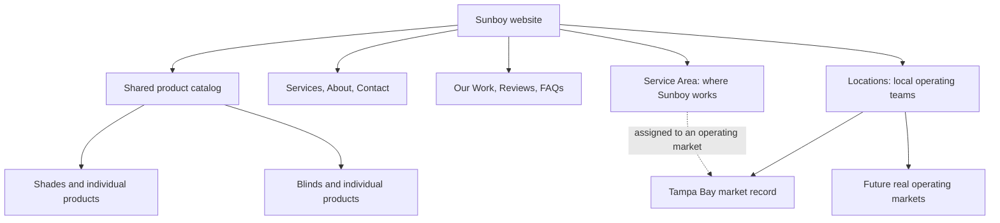

# Sunboy website architecture

Proposed structure, November 19, 2026. This is a plan and an unpublished page scaffold. The live website still has 13 routes. The new outlines live outside `dist/`, Netlify's publish directory.

## Recommended foundation

Use one primary Sunboy website with a shared product catalog and a separate layer for local operations. Start with Tampa Bay. Add a reusable location page when a real additional operation is ready, using the same structure for company-owned and future franchise locations.

This keeps the current product URLs stable and makes room for local teams, contact details, coverage, product availability, project photos, reviews, and consultation routing.

The diagram describes relationships, not a sequence of clicks. The dropdown continues to offer direct links to categories and products.

## Pages to build next

| Page | Proposed URL | Purpose | Current state |
| --- | --- | --- | --- |
| Services | `/services/` | Explain the confirmed consultation and installation offer | Unpublished outline |
| About | `/about/` | Introduce the real company and team | Unpublished outline |
| Service Area | `/service-area/` | Explain confirmed four-county coverage | Unpublished outline; counties confirmed |
| Our Work | `/our-work/` | Show actual completed Sunboy projects | Unpublished outline; original projects needed |
| Reviews | `/reviews/` | Present authentic reviews and their sources | Unpublished outline; verified sources needed |
| FAQs | `/faqs/` | Answer real consultation, installation and product questions | Unpublished outline |
| Privacy | `/privacy/` | Explain the actual forms, providers and data use | Unpublished outline; complete around the chosen setup |

Services, About, and Service Area are the first priority because they already appear in the navigation as detail dialogs. Once their page layouts and useful content are ready, those menu items should become normal page links.

The draft files contain section placeholders and inputs needed, rather than finished marketing copy:

- [Services outline](drafts/services.md)
- [About outline](drafts/about.md)
- [Service Area outline](drafts/service-area.md)
- [Our Work outline](drafts/our-work.md)
- [Reviews outline](drafts/reviews.md)
- [FAQs outline](drafts/faqs.md)
- [Privacy outline](drafts/privacy.md)

## Shared product library

Keep the existing category and product URLs:

- `/shades/` with Roller, Solar, Honeycomb, and Woven Wood Shade pages.
- `/blinds/` with Horizontal and Vertical Blind pages.
- `/indoor/smartdrape/`.
- `/outdoor/exterior-retractable-screens/`.

The existing homepage, contact page, accessibility page, catalog pages, and SmartDrape redirect remain in place. There is no URL migration in this architecture change.

Each future market can reference its available product IDs. Product information stays centrally maintained. If a particular local offering later merits a separate page, decide that from its actual purpose and evidence rather than generating a city-by-product grid by default.

Shutters remain a confirmation item: they appear in the earlier approved homepage row, but were absent from the latest detailed product lineup. A `/shutters/` route is reserved conditionally; no new offering page is published.

## Local operations and service areas

| Page type | Example or pattern | What belongs there |
| --- | --- | --- |
| Operating-market directory | `/locations/` | A useful selector for real operating markets, once needed |
| Local operation | `/locations/fl/tampa-bay/` | The real local team, contacts, available products, coverage, work and reviews |
| City coverage | `/service-area/{city-state}/` | Confirmed coverage, useful local details and links to the responsible operation |
| Project | `/our-work/{project-slug}/` | Original work tied to a product, city and operating market |

The initial Tampa Bay market serves Pinellas, Hillsborough, Manatee, and Sarasota counties. This remains one operating market. Its location-page route is reserved now, with an [unpublished outline](drafts/tampa-bay-market.md). No other market, office, address, local phone or Google Business Profile is invented.

At launch, the homepage and Service Area page can explain the initial Tampa Bay coverage. A separate Tampa Bay operation page becomes useful when it has distinct local team/contact/project information, and before the homepage evolves into a broader brand page as other markets open. Avoid making two pages interchangeable.

A city page describes where the team works. It does not imply a staffed office or a separate business location. City routes include the state in their slug to distinguish places with the same name. Their assignment to a stable market ID can change without changing the city's URL.

Google's Business Profile guidance distinguishes service coverage from separately staffed operating locations. Separate service-business profiles require eligible real locations with separate staff and service areas; adding website city pages does not establish that eligibility. [Google Business Profile guidelines](https://support.google.com/business/answer/3038177?hl=en)

City pages should help someone in that city, supported by actual coverage and local material. Google identifies substantially similar regional/city pages that funnel users to a common destination as examples of doorway abuse. This is a reason to plan useful local pages selectively, not a rule that all city pages are inappropriate. [Google's doorway policy](https://developers.google.com/search/docs/essentials/spam-policies#doorway-abuse)

## Confirmed launch coverage

The owner confirmed these four Florida counties on November 19, 2026. “Hillsboro” was interpreted as Hillsborough County using the [official Hillsborough County name](https://hcfl.gov/).

| County | Planned coverage page | Outline |
| --- | --- | --- |
| Pinellas County | `/service-area/pinellas-county-fl/` | [Draft outline](drafts/pinellas-county-fl.md) |
| Hillsborough County | `/service-area/hillsborough-county-fl/` | [Draft outline](drafts/hillsborough-county-fl.md) |
| Manatee County | `/service-area/manatee-county-fl/` | [Draft outline](drafts/manatee-county-fl.md) |
| Sarasota County | `/service-area/sarasota-county-fl/` | [Draft outline](drafts/sarasota-county-fl.md) |

These are county coverage pages for the same initial operation. They do not establish four branches. Keep the pages unpublished while they contain placeholders, then add genuinely useful local material before launch. City pages can be considered later without duplicating every product across every city.

## Data that allows expansion

[markets.json](markets.json) contains a single initial Tampa Bay record, with unknown details left empty. Its stable market ID is `tampa-bay-fl`. The structure has room for:

- The operating team/entity and ownership model.
- Verified contacts, customer-visit model and hours.
- Confirmed launch counties, with room for city/postal-code details later.
- Local product availability referencing the shared catalog.
- Original projects and verified review sources.
- The destination for consultation requests.

The record does not assume an office, a public address, a franchise operator or an active form destination. Online form delivery stays deferred as previously requested.

Later, the shared `/contact/` journey can receive validated market/product context and route the request to that market's configured destination. The visible three-field form does not change in this planning phase. Requests without a determined market need a defined central handling path before routing is activated.

Future local editors can maintain their own market information while brand/product content stays centrally controlled. That is a future permissions requirement, not an implemented CMS or account system.

## Reserved for later

- `/locations/` and real market pages when the directory and local operation content are useful.
- `/resources/` and individual guides when original content is ready to maintain.
- `/franchise/` only when an actual approved franchise offer exists.
- Separate service-detail pages only when there is a confirmed service and a distinct reason for the page.

The business can start with one local operation. Reserving these routes does not make franchise language part of the customer-facing site today.

## Placeholder and publishing approach

Keep new outlines and placeholder content outside the public build. Publish a page when it has a useful purpose and enough verified content to serve that purpose. Only live pages belong in public navigation and the XML sitemap.

If a hosted review environment is needed later, use a controlled preview. A `noindex` rule can control search indexing when Google can crawl it; it is not access control, and a robots.txt block can prevent Google from seeing the rule. No index-control or hosting settings were changed in this phase. [Google's indexing guidance](https://developers.google.com/search/docs/crawling-indexing/block-indexing)

## Next steps

1. Confirm the final business domain. The current configured origin is the Netlify subdomain; no business domain has been supplied here. Launch coverage is already confirmed at county level.
2. Review the page map and build the Services, About, and Service Area layouts from the existing Sunboy design, using the unpublished outlines.
3. Build the four county coverage templates using the confirmed service area. Add real team/contact information and original projects; select city pages later as useful local material becomes available.
4. Complete supporting pages and connect the consultation form when its actual destination is chosen.
5. Reuse the market template when a real new operation opens. Review shared Tampa Bay-specific wording before introducing a broader brand homepage and catalog presentation.

## Source files and validation

- [routes.json](routes.json): 13 live routes, proposed pages, statuses, parent relationships, reserved patterns and navigation plan.
- [markets.json](markets.json): initial operating-market record and future routing requirements.
- [drafts/](drafts/): twelve unpublished page outlines, including four county hubs.

Run `python3 scripts/check_site_architecture.py` from the repository root to verify route uniqueness, parent relationships, market references, live-file/sitemap coverage, and exclusion of the new draft routes from the live output. This is a project consistency check; it is not a ranking forecast or a full SEO audit.
